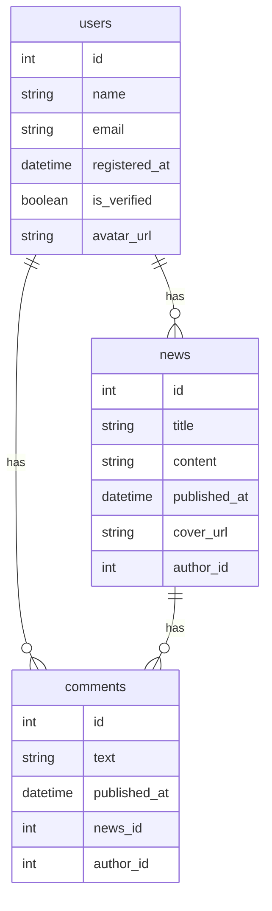

# Установка проекта
```bash
git clone https://github.com/itmo-webdev/lab1_Barkova_A_M.git
cd lab1_Barkova_A_M
```

# Настройка окружения
```bash
cp .env.example .env
```

# Запуск
```bash
docker compose up -d --build
```

# Остановка
```bash
docker compose down [-v]
```

# ERD


# Примеры работы всех эндпоинтов:
## 1. Регистрация пользователя
```bash
curl -s -X POST http://127.0.0.1:8000/api/v1/auth/register \
  -H "Content-Type: application/json" \
  -d '{"name":"Jack","email":"jack@example.com","password":"123456"}' | jq .
```

Ответ сервера:
```json
{
  "access": "<ACCESS_TOKEN>",
  "refresh": "<REFRESH_TOKEN>"
}
```

## 2. Логин
```bash
curl -s -X POST http://127.0.0.1:8000/api/v1/auth/login \
  -H "Content-Type: application/json" \
  -d '{"email":"jack@example.com","password":"123456"}' | jq .
```

Ответ сервера:
```json
{
  "access": "<ACCESS_TOKEN>",
  "refresh": "<REFRESH_TOKEN>"
}
```

## 3. Обновление токена
```bash
curl -s -X POST http://127.0.0.1:8000/api/v1/auth/refresh \
  -H "Content-Type: application/json" \
  -d "{\"refresh\":\"$REFRESH_TOKEN\"}" | jq .
```

Ответ сервера:
```json
{
  "access": "<ACCESS_TOKEN>",
  "refresh": "<REFRESH_TOKEN>"
}
```

## 4. Logout
```bash
curl -i -X POST http://127.0.0.1:8000/api/v1/auth/logout \
  -H "Content-Type: application/json" \
  -d "{\"refresh\":\"$REFRESH_TOKEN\"}"
```

## 5. Мои сессии
```bash
curl -s http://127.0.0.1:8000/api/v1/auth/sessions \
  -H "Authorization: Bearer $ACCESS_TOKEN" | jq .
```

Ответ сервера:
```json
[
  {
    "id": 4,
    "user_agent": "curl/8.7.1",
    "ip": "127.0.0.1",
    "created_at": "2025-10-21T13:32:07.722354Z",
    "expires_at": "2025-11-04T13:32:07.722022Z",
    "revoked": false
  },
  {
    "id": 3,
    "user_agent": "curl/8.7.1",
    "ip": "127.0.0.1",
    "created_at": "2025-10-21T13:31:01.044560Z",
    "expires_at": "2025-11-04T13:31:01.043766Z",
    "revoked": true
  },
  {
    "id": 2,
    "user_agent": "curl/8.7.1",
    "ip": "127.0.0.1",
    "created_at": "2025-10-21T13:29:28.571652Z",
    "expires_at": "2025-11-04T13:29:28.571377Z",
    "revoked": true
  },
  {
    "id": 1,
    "user_agent": "curl/8.7.1",
    "ip": "127.0.0.1",
    "created_at": "2025-10-21T13:28:51.670627Z",
    "expires_at": "2025-11-04T13:28:51.669924Z",
    "revoked": false
  }
]
```

## 6. GitHub OAuth
Перейти по ссылке:
[GitHub Login](http://localhost:8000/api/v1/auth/github/login)
Авторизоваться через GitHub.
После редиректа получить JSON с токенами:
```json
{
  "access": "<ACCESS_TOKEN>",
  "refresh": "<REFRESH_TOKEN>"
}
```

## 7. Список пользователей
```bash
curl -s http://127.0.0.1:8000/api/v1/users/ \
  -H "Authorization: Bearer $ACCESS_TOKEN" | jq .
```

Ответ сервера:
```json
[
  {
    "name": "Alice",
    "email": "alice@example.com",
    "avatar_url": null,
    "id": 1,
    "registered_at": "2025-10-21T13:28:26.267324Z",
    "is_verified_author": false
  },
  {
    "name": "Bob",
    "email": "bob@example.com",
    "avatar_url": null,
    "id": 2,
    "registered_at": "2025-10-21T13:28:26.267324Z",
    "is_verified_author": false
  },
  {
    "name": "Eve",
    "email": "eve@example.com",
    "avatar_url": null,
    "id": 3,
    "registered_at": "2025-10-21T13:28:26.267324Z",
    "is_verified_author": false
  },
  {
    "name": "Jack",
    "email": "jack@example.com",
    "avatar_url": null,
    "id": 4,
    "registered_at": "2025-10-21T13:28:51.599500Z",
    "is_verified_author": false
  }
]
```

## 8. Верификация пользователей админом
```bash
curl -s -X POST http://127.0.0.1:8000/api/v1/users/4/verify \
  -H "Authorization: Bearer $ACCESS_TOKEN" \
  -H "Content-Type: application/json" \
  -d '{"is_verified_author": true}' | jq .
```

Ответ сервера:
```json
{
  "name": "Jack",
  "email": "jack@example.com",
  "avatar_url": null,
  "id": 4,
  "registered_at": "2025-10-21T13:28:51.599500Z",
  "is_verified_author": true
}
```

## 9. Список новостей
```bash
curl -s http://127.0.0.1:8000/api/v1/news/ \
  -H "Authorization: Bearer $ACCESS_TOKEN" | jq .
```

Ответ сервера:
```json
[
  {
    "title": "Alice first post",
    "content": {
      "blocks": [
        "seed post 1"
      ]
    },
    "cover_url": null,
    "id": 1,
    "published_at": "2025-10-21T13:28:26.267324Z",
    "author_id": 1
  },
  {
    "title": "Bob's update",
    "content": {
      "blocks": [
        "seed post 2"
      ]
    },
    "cover_url": null,
    "id": 2,
    "published_at": "2025-10-21T13:28:26.267324Z",
    "author_id": 2
  }
]
```

## 10. Создание новости
```bash
curl -s -X POST http://127.0.0.1:8000/api/v1/news/ \
  -H "Authorization: Bearer $ACCESS_TOKEN" \
  -H "Content-Type: application/json" \
  -d '{"title":"First post","content":{"text":"hello"},"cover_url":null}' | jq .
```

Ответ сервера:
```json
{
  "title": "First post",
  "content": {
    "text": "hello"
  },
  "cover_url": null,
  "id": 3,
  "published_at": "2025-10-21T13:35:51.068596Z",
  "author_id": 4
}
```

## 11. Редактирование своей новости
```bash
curl -s -X PATCH http://127.0.0.1:8000/api/v1/news/3 \
  -H "Authorization: Bearer $ACCESS_TOKEN" \
  -H "Content-Type: application/json" \
  -d '{"title":"Updated title"}' | jq .
```

Ответ сервера:
```json
{
  "title": "Updated title",
  "content": {
    "text": "hello"
  },
  "cover_url": null,
  "id": 3,
  "published_at": "2025-10-21T13:35:51.068596Z",
  "author_id": 4
}
```

## 12. Удаление новости
```bash
curl -i -X DELETE http://127.0.0.1:8000/api/v1/news/3 \
  -H "Authorization: Bearer $ACCESS_TOKEN"
```

## 13. Список комментариев
```bash
curl -s http://127.0.0.1:8000/api/v1/comments/ \
  -H "Authorization: Bearer $ACCESS_TOKEN" | jq .
```

Ответ сервера:
```json
[
  {
    "text": "seed comment 1",
    "id": 1,
    "published_at": "2025-10-21T13:28:26.267324Z",
    "news_id": 1,
    "author_id": 3
  },
  {
    "text": "seed comment 2",
    "id": 2,
    "published_at": "2025-10-21T13:28:26.267324Z",
    "news_id": 2,
    "author_id": 1
  }
]
```

## 14. Создание комментария
```bash
curl -s -X POST http://127.0.0.1:8000/api/v1/comments/ \
  -H "Authorization: Bearer $ACCESS_TOKEN" \
  -H "Content-Type: application/json" \
  -d '{"text":"nice post!","news_id":1}' | jq .
```

Ответ сервера:
```json
{
  "text": "nice post!",
  "id": 3,
  "published_at": "2025-10-21T13:37:18.635393Z",
  "news_id": 1,
  "author_id": 4
}
```

## 15. Редактирование комментария
```bash
curl -s -X PATCH http://127.0.0.1:8000/api/v1/comments/3 \
  -H "Authorization: Bearer $ACCESS_TOKEN" \
  -H "Content-Type: application/json" \
  -d '{"text":"edited comment"}' | jq .
```

Ответ сервера:
```json
{
  "text": "edited comment",
  "id": 3,
  "published_at": "2025-10-21T13:37:18.635393Z",
  "news_id": 1,
  "author_id": 4
}
```
